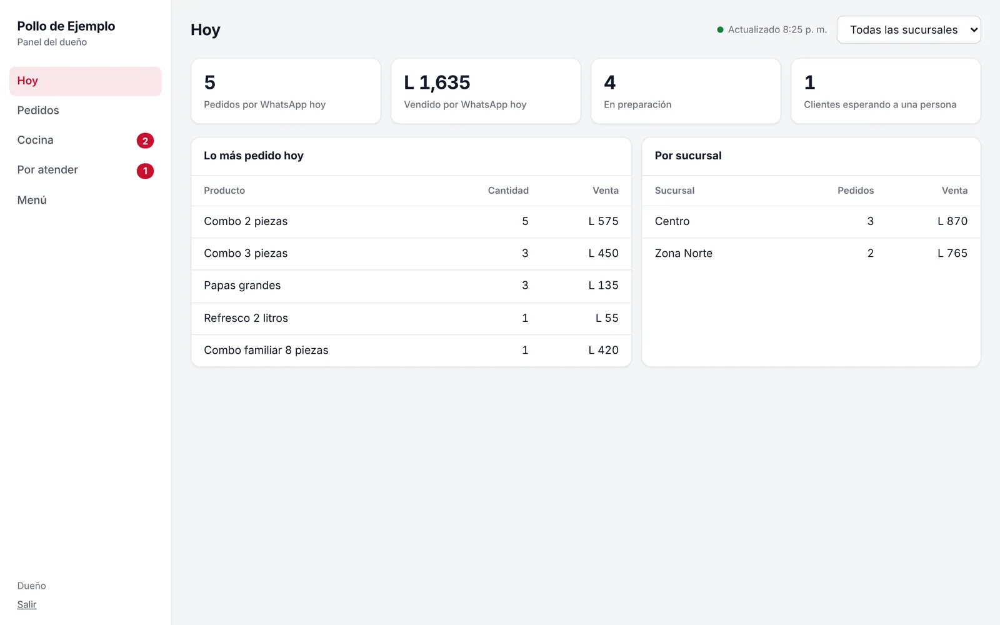
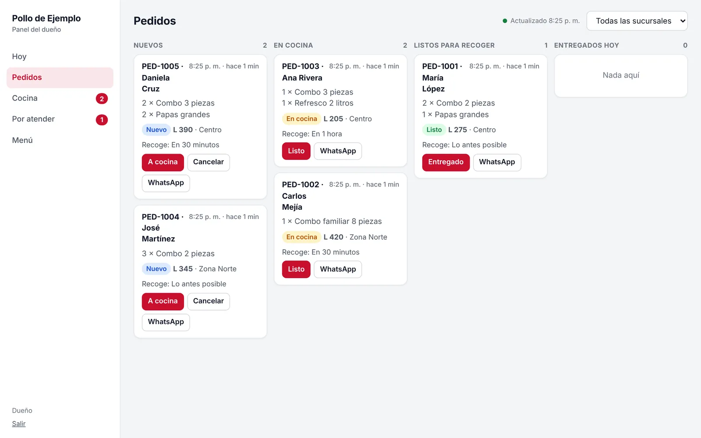
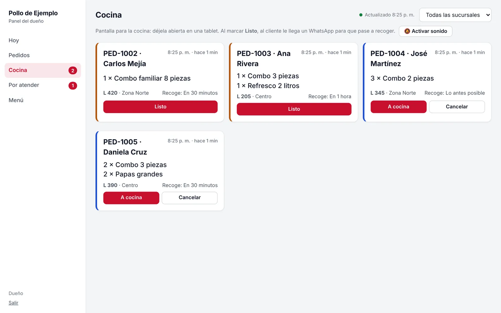
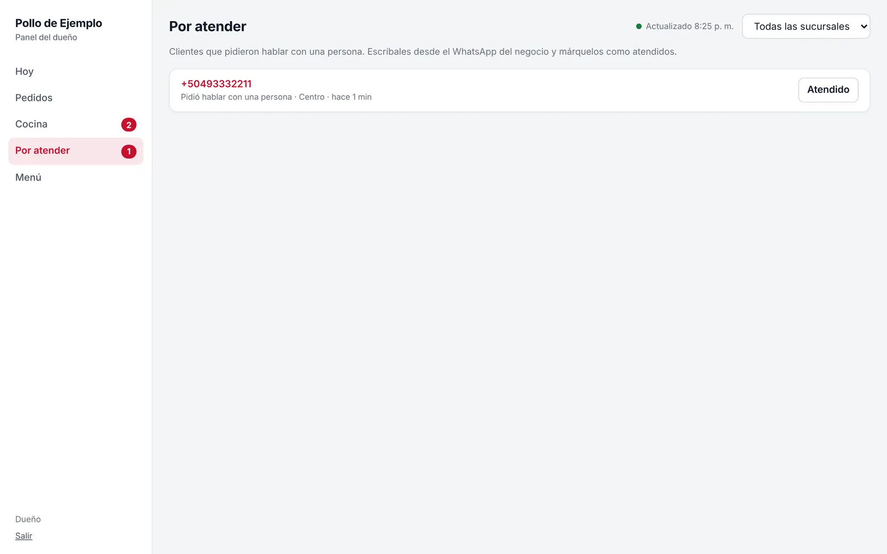
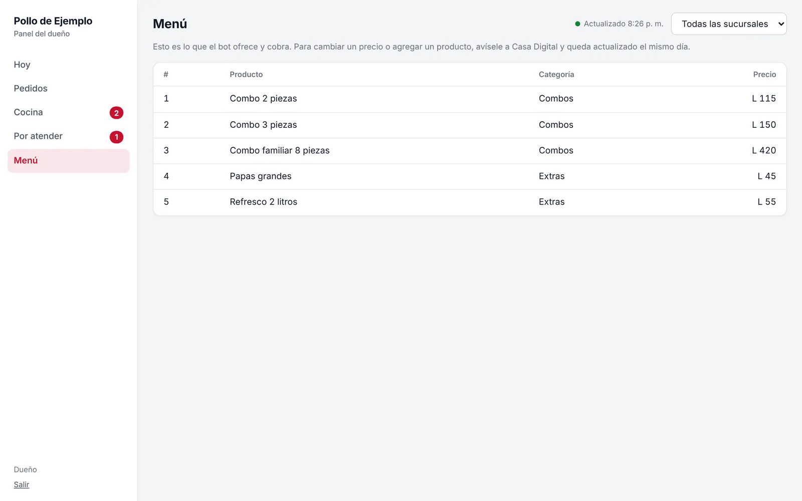

<!-- portada: Guía del panel -->
# Su panel, paso a paso.

Todo lo que pasa en [Restaurante], en una sola pantalla: los pedidos, la cocina y los clientes que esperan una respuesta.

## Entrar

Las imágenes son del restaurante de ejemplo. Su panel se ve igual, con su nombre, su menú y sus colores.

1. Abra en el celular o la computadora la dirección que le mandamos por WhatsApp (termina en `/panel`).
2. Escriba su correo y su contraseña. La primera vez use la temporal que le mandamos y cámbiela.
3. La sesión dura 12 horas. Después le vuelve a pedir la contraseña.
4. Si alguien se equivoca 5 veces seguidas, el panel lo bloquea un rato. Es normal: es para que nadie adivine su contraseña.

Guárdela como acceso directo: en el celular, abra el menú del navegador y toque **Agregar a pantalla de inicio**.

## Hoy

Lo primero que ve: cuánto se vendió hoy, cuántos pedidos hay en preparación, cuántos clientes esperan a una persona, lo más pedido y cómo va cada sucursal.

## Pedidos

Todos los pedidos que entraron por WhatsApp, con el nombre del cliente, lo que pidió, el total, la sucursal y la hora en que recoge. Cada pedido avanza así:

**Nuevo** → **A cocina** → **Listo** → **Entregado**

- **Cancelar** solo aparece mientras el pedido es nuevo.
- El botón **WhatsApp** abre la conversación con ese cliente, por si quiere confirmarle algo.

## Cocina

Para dejar abierta en una tablet o un celular en la cocina. Toque **Activar sonido** para que suene cada pedido nuevo. Cuando el pedido esté listo, toque **Listo**: al cliente le llega un WhatsApp con el número de pedido, la sucursal y el total para que pase a recoger.

## Por atender

Clientes que pidieron hablar con una persona (una duda, una queja, algo que no está en el menú). Toque el número para escribirle por WhatsApp y, cuando lo atienda, toque **Atendido**. Revise esta sección varias veces al día: es lo único que el bot deja en sus manos.

## Menú

El menú y los precios que el bot les da a sus clientes. Revíselo de vez en cuando. Si algo cambió, mándenos un WhatsApp y lo actualizamos.

## Desde su WhatsApp

- Cada pedido nuevo y cada cliente que pide una persona le llega como aviso.
- Escríbale **pedidos** al número del bot y le contesta con todo lo que está pendiente.

## Si pasa algo

| Si... | Haga esto |
|---|---|
| El bot no contesta | Escríbanos a cualquier hora al +1 (765) 543-4251. |
| Un precio o un horario está mal | Mándenos el dato correcto; lo cambiamos el mismo día. |
| Un cliente se queja de una respuesta del bot | Mándenos captura; corregimos la respuesta. |
| Alguien del personal ya no debe entrar | Avísenos y le quitamos el acceso. |
| Olvidó la contraseña | Avísenos y le mandamos una nueva. |

